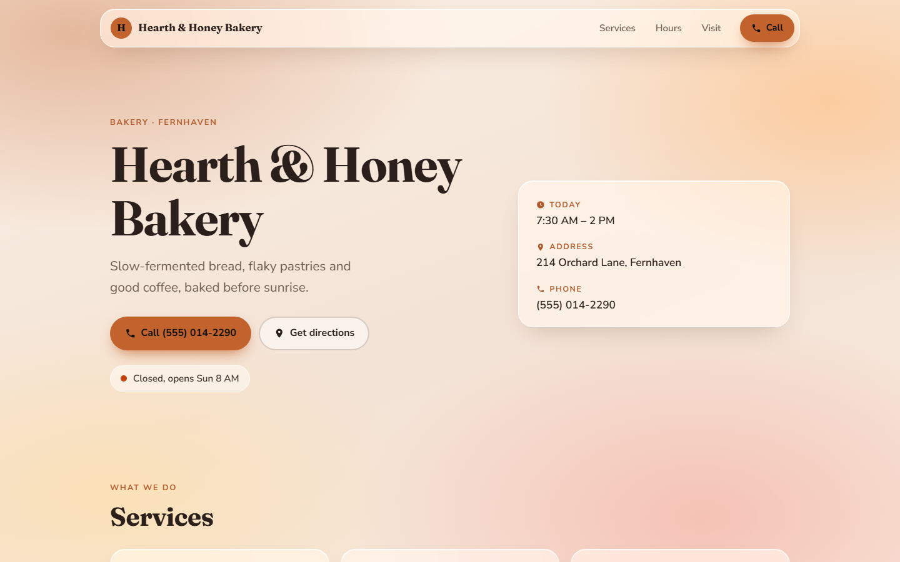
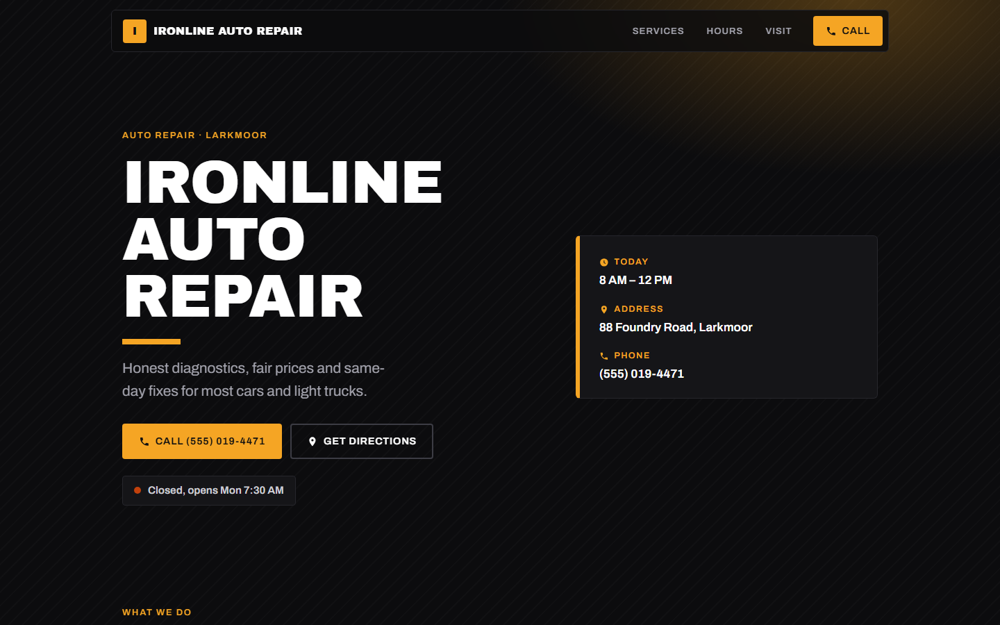
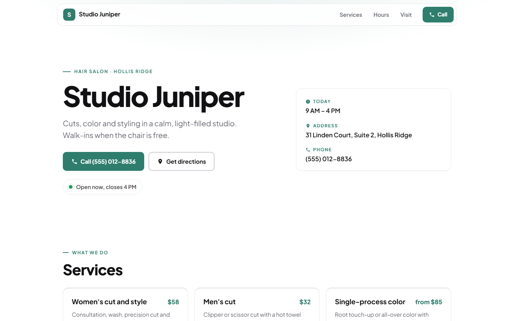

# local-business-site

[](https://github.com/chasebuilds/local-business-site/actions/workflows/ci.yml) [](https://chasebuilds.github.io/local-business-site/)  [](LICENSE)

**For local businesses (bakeries, salons, repair shops and the like) that need a simple website that works on phones.** Fill in one file with your hours, services, phone number and reviews, and get a finished page you can put online for free.

**Live demos:** [all three](https://chasebuilds.github.io/local-business-site/) | [bakery (warm)](https://chasebuilds.github.io/local-business-site/bakery/) | [auto repair (bold)](https://chasebuilds.github.io/local-business-site/auto-repair/) | [hair salon (clean)](https://chasebuilds.github.io/local-business-site/hair-salon/)

Turns one YAML file into a fast, mobile-first, one-page website for a small local business: a hero with call, quote and directions buttons, trust badges, reviews, services with prices, a service area, an hours table that highlights today and shows "open now", a map, an FAQ, contact links, a sticky Call and Directions bar on phones and a footer. The output is a single `index.html` with the CSS inlined, so it can go on any static host.

The demo businesses are invented. Names, towns, addresses, 555 phone numbers and the reviews are fictional (each review is labeled "Fictional review").

## Three themes

| warm | bold | clean |
|---|---|---|
|  |  |  |
| Frosted glass panels over a painted warm backdrop, serif headings | Dark, heavy uppercase type, the brand color as a bright accent | White and neutral, crisp lines, follows the visitor's light or dark setting |

## Make a mockup in 2 minutes

Windows (on macOS or Linux use `.venv/bin/` in place of `.venv\Scripts\`):

```
python -m venv .venv
.venv\Scripts\python -m pip install -e .
.venv\Scripts\sitegen new site.yml
```

Open `site.yml` and fill in the business: name, tagline, type, town, phone, address, hours, services and a brand color. Then:

```
.venv\Scripts\sitegen build site.yml -o out/ --theme warm
```

Open `out\index.html` in a browser. Try `--theme bold` and `--theme clean` to compare. Upload the `out` folder to any static host (GitHub Pages, Netlify, Cloudflare Pages) to publish it.

## The YAML file

```yaml
name: Hearth & Honey Bakery
tagline: Slow-fermented bread, flaky pastries and good coffee.
type: bakery                 # sets the schema.org type (Bakery, AutoRepair, HairSalon, ...)
town: Fernhaven
phone: (555) 014-2290
email: hello@example.com     # optional
address:
  street: 214 Orchard Lane
  region: ST                 # optional
  postal_code: "00000"       # optional
timezone: America/New_York   # optional, used by the "open now" badge
hours:                       # 9:00-17:00, 8am-2pm, "8:00-12:00, 13:00-17:00", 18:00-2:00, or closed
  mon: closed
  tue: 7:00-15:00
  sat: 7:30-14:00
services:                    # plain names, or name / price / description
  - name: Country sourdough
    price: 9
    description: Two-day ferment, crackly crust.
  - Celebration cakes
photos: []                   # none, or 3 to 6 file paths (copied next to the page) or https URLs
links:
  facebook: https://facebook.com/...
  google: https://g.page/...
  instagram: https://instagram.com/...
color: "#c2622d"             # text and button shades are adjusted to keep 4.5:1 contrast
theme: warm                  # warm, clean or bold
map: true                    # Google map embed of the address; false shows a link card instead
url: https://example.com/    # optional: canonical link, og:url, robots.txt and sitemap.xml
```

### Optional fields that help a site convert

All of these are optional. A YAML file from v0.1 builds exactly as before, with the footer credit now a link.

```yaml
credit: true                 # default true: footer link "Site by Chase Builds"; false removes it
trust:                       # short badges under the hero buttons
  - Licensed and insured
  - Family owned
  - Since 1986
testimonials:                # 2 to 4, shown right under the hero. Real customer words only.
  - quote: Fixed my brakes the same day and showed me the worn pads.
    name: Pat R.
    source: Google review    # optional
  - quote: Fair price, no surprises.
    name: Lee M.
service_area:                # towns or counties; shown in a section and added to JSON-LD areaServed
  - Fernhaven
  - Mill Creek
  - Ash County
faq:                         # shown as open/close questions plus FAQPage JSON-LD
  - question: Do I need an appointment?
    answer: Walk-ins are welcome before 3 PM.
quote_cta: true              # "Request a free quote" button, or your own label as text
sms: false                   # true: the quote button opens a prefilled text to `phone`
og_image: https://example.com/share.jpg   # optional share image (https)
```

| Field | What it does | Notes |
|---|---|---|
| `credit` | Footer link "Site by Chase Builds" to the Chase Builds GitHub page, opens in a new tab | On unless set to `false` |
| `trust` | Pill badges under the hero buttons | Keep them true and checkable: license, insurance, years, ownership |
| `testimonials` | Reviews section right after the hero, plus a Reviews link in the nav | 2 to 4 items, each needs `quote` and `name`, `source` is optional. Never invent reviews for a real business; no stars or ratings are drawn |
| `service_area` | "Service area" section listing the towns, and `areaServed` in the LocalBusiness JSON-LD | Useful for trades that drive to the customer |
| `faq` | Questions section with expandable answers, plus a FAQPage JSON-LD block | Each item needs `question` and `answer` |
| `quote_cta` | A quote button in the hero and the contact section | `true` for "Request a free quote" or text for your own label. Opens a prefilled email to `email`, or a prefilled text to `phone` when `sms: true`. Needs one of the two. No form backend |
| `sms` | Sends the quote button to a text message instead of email | Default `false` |
| `og_image` | The image shown when the link is shared | Falls back to the first photo (a local photo needs `url` so the link is absolute) |
| `url` | Canonical link and `og:url`, and writes `robots.txt` and `sitemap.xml` next to `index.html` | Must start with https:// |

Built in, no field needed: the title reads `<Business> | <Type> in <town>, <region>`, the favicon is the brand initial drawn as an inline SVG, a sticky Call and Directions bar shows on phones, and every button and nav link is at least 44px tall.

Days left out are shown as closed. Full examples: [examples/](examples).

Mistakes are reported all at once with the field name, for example:

```
error: site.yml has 2 problem(s):
  - `hours.tue`: 'nine' is not a time like 9:00, 17:30 or 5pm
  - `color` 'orange' must be a hex color like #b5523b
```

## What the page includes

- Semantic HTML with a skip link, landmarks and visible focus rings. Buttons and links are at least 44px tall.
- Title and meta description with the business type and town, Open Graph tags, a canonical link, and a LocalBusiness JSON-LD block (address, phone, opening hours, services, service area, links). FAQPage JSON-LD when `faq` is set.
- A sticky bottom bar with Call and Directions on phones.
- `robots.txt` and `sitemap.xml` when `url` is set.
- Google Fonts per theme, a generated favicon, no JavaScript framework. A small inline script marks today's row and shows "Open now, closes 5 PM" or "Closed, opens Tue 7 AM".
- Fade and slide-in on load and hover states, all CSS, switched off for visitors who ask for reduced motion.
- Layout tested at phone width (375px) and desktop.

## What makes these sites work

The optional fields come from a short research pass on what turns a local visitor into a call or a visit. The full notes, with links to Google Search Central, Google Business Profile help, web.dev, W3C WCAG, Nielsen Norman Group and BrightLocal, are in [docs/RESEARCH.md](docs/RESEARCH.md). The short version:

- **Make calling one tap.** The phone number and a Call button sit above the fold, and phones get a sticky Call and Directions bar.
- **Say what and where.** The title, eyebrow and meta description name the business type and the town, which is what local searches match on.
- **Show proof early.** Real reviews (`testimonials`) and checkable trust badges (`trust`) sit right under the hero. Most people read reviews before choosing a local business.
- **Answer the practical questions.** Hours with an "open now" badge, a map, a service area and an FAQ cover most reasons people call.
- **Offer a second way in.** A prefilled quote email or text (`quote_cta`) catches visitors who are not ready to call.
- **Be fast, readable and findable.** One static file, brand colors adjusted to 4.5:1 contrast, 44px tap targets, LocalBusiness JSON-LD, a canonical URL, a sitemap and a share image.

## Development

```
.venv\Scripts\python -m pip install -e ".[dev]"
.venv\Scripts\python -m ruff check .
.venv\Scripts\python -m mypy
.venv\Scripts\python -m pytest
.venv\Scripts\python scripts\build_demos.py   # builds the three demos into _site/
```

The `pages` workflow runs `scripts/build_demos.py` on every push to `main` and deploys `_site/` to GitHub Pages.

## License

MIT. Made by Chase Builds.

## More from Chase Builds

- **[field-service-pwa](https://github.com/chasebuilds/field-service-pwa)**: Phone app for crews: job tickets, photos, parts, time, customer signature and invoice. Works with no signal. ([live demo](https://chasebuilds.github.io/field-service-pwa/))
- **[appointment-booking-api](https://github.com/chasebuilds/appointment-booking-api)**: Online booking that never double-books and gets time zones right. ([live demo](https://chasebuilds.github.io/appointment-booking-api/))
- **[sheets-automations](https://github.com/chasebuilds/sheets-automations)**: Google Sheets that send summaries, invoices, overdue reminders and low-stock alerts on their own. ([live demo](https://chasebuilds.github.io/sheets-automations/))

[All projects, sorted by industry](https://github.com/chasebuilds) · [chasebuilds.github.io](https://chasebuilds.github.io)
